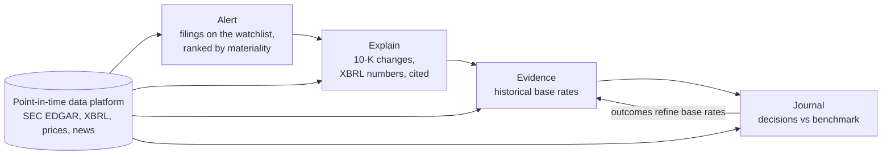
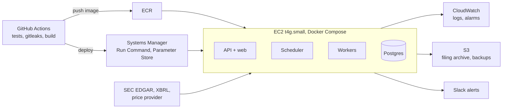

# SentinelStream: product requirements

_As of 20 Nov 2026_

## Summary

SentinelStream is a personal research assistant for a long-horizon US stock investor. It alerts on material SEC filings for a watchlist, explains them from the filings themselves, shows what has historically happened after similar events, and keeps an honest record of decisions against a benchmark.

- **User:** one investor, the owner.
- **Scope:** US stocks and ETFs, held for days to months.
- **Deployment:** AWS from the first milestone, deployed automatically on every merge to `main`.

## Problem

Retail investors miss or misread primary-source events, and common retail tools don't say what usually happens next.

- Broker apps, TradingView, screeners and free insider trackers already cover charts, fundamentals and raw alerts well. SentinelStream links out to them rather than rebuilding them.
- Raw filing alerts are now common, so speed alone isn't the goal. Competing with institutions on speed is not attempted.
- **The gaps SentinelStream fills:** alerts limited to the user's watchlist and ranked by materiality; year-over-year filing changes with numbers from XBRL and cited sources; a historical base rate for each event type; a decision ledger measured against a benchmark.

## Goals and non-goals

**Goals**

1. Never miss a material event on the watchlist.
2. Decide with evidence: every alert carries a base rate from history.
3. Measure results honestly against a benchmark.
4. Run as a real, monitored system on AWS with infrastructure as code and CI/CD.

**Non-goals**

- Trade execution or any broker connection
- Options trading, HFT, intraday data or order books
- Buy or sell recommendations
- Charting, screeners or a general fundamentals UI
- Multi-user SaaS

## Product modules

Four modules form a loop on one point-in-time data platform.

| Module | What it does | v1 must-haves | Later |
| --- | --- | --- | --- |
| Alert | Watches EDGAR for watchlist companies and pushes what matters | 8-K items and Form 4 buys; dedupe; push within minutes; quiet hours | News-based alerts; earnings calendar |
| Explain | Deep dive on a filing or a company | XBRL key financials; 10-K risk-factor and MD&A changes vs last year; every claim cited | Peer comparison; company relationships |
| Evidence | Research harness that produces base rates | As-of data access; event studies at 1/5/20/60 days vs benchmark; costs; sample size and confidence shown | Rank IC across features; sentiment features |
| Journal | Decision log and performance record | Log a decision and thesis from an alert; returns vs QQQ (SPY for reference); alpha and beta split | Position-sizing helper |

## MVP: the walking skeleton

The MVP is the thinnest end-to-end version of Alert, live on AWS.

1. **Watchlist:** seeded tickers, each mapped to its SEC CIK.
2. **Poller:** a scheduled job every 5 minutes reads EDGAR for watchlist companies and stores raw filing metadata, so it can be replayed.
3. **Normaliser:** writes a `filings` table where every row carries `known_at`, the EDGAR acceptance time.
4. **Materiality rules v0:**
    - 8-K items 1.01 (material agreement), 2.02 (results), 4.02 (prior financials unreliable) and 5.02 (director or officer change) = high.
    - Form 4 open-market purchases (transaction code P) = high.
    - Everything else = low, shown in the UI but not pushed.
5. **Notifier:** each high item goes to a Slack channel with a link to the filing, deduplicated by accession number.
6. **Web page:** latest alerts, filterable by ticker, plus a task-runs view.
7. **Ops:** CloudWatch logs and an alarm on failed runs.

**Done when:** a real 8-K from a watchlist company reaches Slack within 10 minutes of acceptance, and deploying is just `git push`.

### Ticker onboarding

Adding a ticker starts an onboarding job that runs through the scheduler and shows as pending, backfilling, then ready:

1. Validate the symbol with the price provider and map it to its SEC CIK.
2. Detect the filer type: a domestic company (10-K, 10-Q, 8-K, Form 4) or a foreign private issuer (20-F, 6-K, no Form 4), and apply the matching alert rules.
3. Backfill two years of filing metadata and daily price bars back to the listing date. Each step is idempotent.
4. Pull XBRL company facts.
5. Add the ticker to the poller's watch set.

Recent IPOs have short price histories, so their base rates come from similar events at other companies until their own history grows.

## Architecture and deployment

Stage 1 runs the whole stack on one EC2 instance with Docker Compose. It is defined in Terraform and deployed by GitHub Actions through OIDC, so no AWS keys are stored anywhere.

| AWS piece | Role | Stage |
| --- | --- | --- |
| Terraform | Every AWS resource as code | 1 |
| GitHub Actions + IAM OIDC role | Test, build, push and deploy with no stored keys | 1 |
| ECR | Container images, tagged by commit | 1 |
| EC2 (t4g.small) + Docker Compose | API, scheduler, workers, Postgres, web | 1 |
| Systems Manager | Deploy step; secrets in Parameter Store | 1 |
| CloudWatch Logs + alarms | Container logs; alarm on failed runs | 1 |
| S3 | Raw filing archive; nightly database backups | 1 |
| AWS Budgets | Monthly spend alarm | 1 |
| RDS PostgreSQL | Managed database | 2 |
| ECS Fargate + load balancer | Containers without managing a server | 2 |
| S3 + CloudFront | Frontend hosting | 2 |

Region: us-east-1. Stage 1 avoids a NAT gateway and load balancer to keep cost low. Stage 2 is optional.

## Data sources and constraints

| Source | Used for | Cost | Constraint |
| --- | --- | --- | --- |
| SEC EDGAR filings | 8-K, 10-K, 10-Q, 20-F, 6-K, Form 4 | Free | Declared User-Agent and client-side rate limiting |
| SEC XBRL APIs (data.sec.gov) | Financial numbers for Explain | Free | Companies use different tags for the same item, so a mapping layer is needed |
| Massive | Daily price bars | Paid plan | Provider rate limits |
| Finnhub | News (later) | Free tier | Short history, rate limits |
| Slack incoming webhook | Alert push | Free | None |
| OpenAI | Explain summaries (later) | Pay per use | Look-ahead bias in backtests; cite-or-reject |

**Known data limits:** historical index membership isn't free, so any research universe is approximate and documented as such (survivorship bias). Price adjustments for splits and dividends come from the bar provider and must be checked.

## Success metrics

| Metric | Target |
| --- | --- |
| Alert latency (EDGAR acceptance to Slack) | Median under 10 minutes |
| Missed material filings on the watchlist | 0 per month, checked against the EDGAR daily index |
| Deployment | Every merge to `main` deploys automatically; rollback = redeploy the previous image tag |
| Pipeline reliability | At least 99% of scheduled runs succeed each week |
| Research correctness | Lookahead blocked by tests; reproduces the direction of a published insider-buying effect |
| AWS cost, stage 1 | US$30 a month or less |

## Milestones

| Milestone | Target | Done when |
| --- | --- | --- |
| M0 Showcase repo on AWS | 23–29 Nov 2026 | Public repo with CI (tests + gitleaks), Terraform, auto-deploy to EC2; core prototype modules carried over |
| M1 Alerts live | 30 Nov – 13 Dec 2026 | Watchlist 8-K and Form 4 alerts reach Slack within 10 minutes; ticker onboarding job |
| M2 Evidence harness | 14 Dec 2026 – 10 Jan 2027 | As-of data access with lookahead tests; event studies with costs; a base rate on each alert; insider-buying effect reproduced |
| M3 Explain | 11–24 Jan 2027 | XBRL fundamentals; 10-K year-over-year diff with citations |
| M4 Journal | 25–31 Jan 2027 | Decision ledger; returns vs QQQ with an alpha and beta split |
| AWS stage 2 (optional) | 1–7 Feb 2027 | RDS, ECS Fargate, S3 + CloudFront |

If time runs short, cut from the bottom (stage 2, then M4).

## Risks

- **AWS cost surprises:** Budgets alarm from day 1; no NAT gateway or load balancer in stage 1.
- **EDGAR throttling:** declared User-Agent, backoff and caching.
- **Small samples for rare events:** base rates always show sample size and a confidence range, and pool across similar stocks when the sample is small.
- **LLM errors:** numbers come only from XBRL; text claims without a citation are rejected.
- **Scope creep:** options, news and UI polish stay out of the core milestones.
